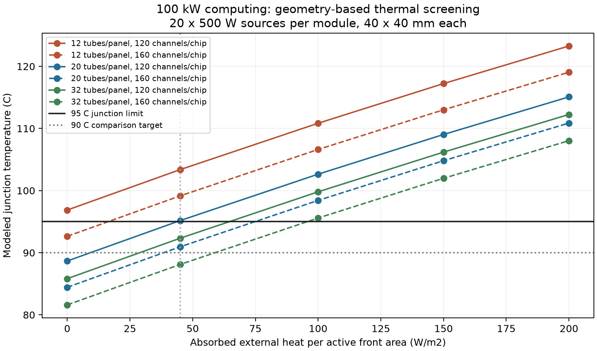

# 100 kW単機：外部熱環境と構造モデル v0.1

2026-10-05。[配管v0.2](100kW単機_単相熱輸送v0.2.md)と[熱収支スクリーニング](100kW単機_熱収支スクリーニングv0.1.md)を引き継ぐ。主放熱面183.44 m²、2独立ループ、1.25 kg/s/系、計算熱100 kWを維持し、パネルと冷却板の熱抵抗を**明示した寸法から計算する比較構造**へ進めた。寸法、材質の熱伝導率、チップ配置は設計仮定であり、実TPU/AIチップや飛行認定品の性能値ではない。

**今回の結果。** 1モジュールを**20個×500 W、各熱源40 mm角**とする場合、パネル20管/枚＋冷却板120流路/チップの基準構造では、外部吸収45 W/m²で最高接合部約**95.17°C**。今回計算した層・流路だけでも95°Cをわずかに超え、未知の接触・局所拡散損失を入れる余裕がない。32管/枚＋160流路/チップなら約**88.11°C**となるが、外部吸収100 W/m²では約**95.59°C**へ上がる。後者で90°Cを比較目標にするには、外部吸収を約**58.55 W/m²以下**に抑える必要がある。90°Cは95°C上限から5 Kの余裕を置いた今回の比較目標で、規格値ではない。従来の**10個×1 kW**という例を同じ40 mm角と流路寸法で計算すると、32管＋160流路でも約**108.65°C**となり、通らない。

**レビューの補正。** 従来の`R''=0.010`では、平均流体―平均表面の温度差は`R'' Q/A≈5.45 K`である。約10.55 Kは「熱い側の流体―平均表面」の差で、同じ量ではない。またチップ側の厳密な許容差は24.985 Kなので、25 Kを足すと95.015°Cで上限をわずかに超える。今回はポンプ熱も主ループへ振り分け、既存の補機17.65 kW枠から同額を引く。

**外部吸収45 W/m²への依存。** 以下の`q_abs`は放熱する前面1 m²当たりの吸収熱を表す。0/45/100/150/200 W/m²は均一・定常の感度入力であり、特定軌道のhot/nominal/coldケースや年間保証値ではない。日射、アルベド、地球IR、周囲構体の放射を分ける必要があることは[NASAの熱設計資料](https://ntrs.nasa.gov/api/citations/20230003714/downloads/Thermal%20Design%20for%20Spaceflight.pptx.pdf)に基づく。

```text
q_abs = α_s S μ_sun + α_s a S F_albedo
        + ε_IR I_Earth F_Earth + q_backload
q_net = ε_IR σ T_surface⁴ − q_abs
```

`μ_sun`は照射時の太陽入射角のcos（遮蔽・食では0）、`F_albedo`は照らされた地球とその反射方向を含む幾何係数、`F_Earth`は地球IRの視野係数。両係数は同一ではない。`q_backload`は他の構体・太陽電池・パネルからの吸収放射等で、重複計上を避ける。具体的な軌道・β角・姿勢は未設定であり、今回はこれらを数値伝播していない。

例示として`S=1361 W/m²`、`a=0.30`、`I_Earth=237 W/m²`、`α_s=0.15`、`ε_IR=0.85`を置くと、

```text
q_abs = 204.15 μ_sun + 61.245 F_albedo + 201.45 F_Earth + q_backload
```

となる。これは光学特性・環境値の**仮定例**で、選定コーティングのBOL/EOLデータではない。日射・アルベド・backloadを0とした場合でも、45 W/m²には`F_Earth≤0.223`が必要。高度650 kmで地球の中心へ向けた平面という幾何例では、地球半径6371 kmとして`F_Earth=(6371/7021)²≈0.823`、地球IRだけで約166 W/m²となる。この入力では32管＋160流路案でも約**103.94°C**となる。45 W/m²を使うためには、深宇宙へ向ける面配置や遮蔽を具体化する必要がある。

**パネル構造。** 主パネル1枚を、前面だけが放射する2.5 m×9.172 m＝22.93 m²の活性面とする。背面は断熱、前面の遮蔽・支持部・非放射部による面積損失は今回0の比較仮定。以前の「有効面積」を、今回だけはこの片面活性幾何面積へ対応させた。8枚で183.44 m²。実機の面積と一致することは未確認であり、両面の効果は加えていない。

各パネル内に9.172 mの並列管を12/20/32本配置する。管内径6 mm・外径8 mm、アルミニウム相当の管/スキン熱伝導率160 W/(m K)、スキン厚1 mm、管―面接合層厚0.1 mm・熱伝導率5 W/(m K)・接合幅6 mmを仮定。これらは熱計算用で、流体適合性や耐圧を満たした材質・接合仕様ではない。

```text
管間隔 p = 2.5 m / 管数
管内流量 = (1.25/4) / 管数                    [kg/s]
R''conv = p/(h π D_i)
R''wall = p ln(D_o/D_i)/(2π k_tube)
R''bond = p t_bond/(k_bond w_bond)
R''spread ≈ p²/(12 k_skin t_skin)
R''panel = R''conv + R''wall + R''bond + R''spread
```

最後の面内拡散式は、管線間の薄い板が均一熱流束で放熱する1次元近似。実際の面内温度分布・非線形放射・支持構造の影響は未解決で、計算した`R''`を流れ方向に分割した放射モデルへ戻す。管間隔、管―面接合と伝導フィンを別に扱う方針は[NASAの放熱器解析](https://ntrs.nasa.gov/api/citations/19920001920/downloads/19920001920.pdf)に整合する。

| パネル管数 | 管間隔 | Re | 管内h | 導出した`R''panel` | 内部直管圧損/パネル |
|---:|---:|---:|---:|---:|---:|
| 12本 | 208.3 mm | 11,833 | 7,076 W/(m² K) | 0.02492 m² K/W | 19.82 kPa |
| 20本 | 125.0 mm | 7,100 | 4,458 W/(m² K) | 0.01008 m² K/W | 8.25 kPa |
| 32本 | 78.1 mm | 4,438 | 2,804 W/(m² K) | 0.00494 m² K/W | 3.72 kPa |

20本案の抵抗内訳は、対流0.001487、管壁0.000036、接合0.000417、面内拡散0.008138 m² K/W。**約81%が面内拡散**であり、管を増やすと1管当たりのhは下がるが、間隔が狭まり全体の熱抵抗は下がる。外部吸収45 W/m²・ポンプ熱込みでは、平均流体―表面差は**5.53 K**、最熱流体―平均表面差は**10.66 K**である。

管内hはGnielinski式、摩擦係数はPetukhov式を用い、今回のReは4,000以上。[Los Alamosの公開解析](https://www.osti.gov/servlets/purl/1371677)に記載された形で計算する。水の`ρ=983 kg/m³, μ=0.000467 Pa·s, cₚ=4,000 J/(kg K), k_f=0.653 W/(m K)`は約60°Cの比較物性を固定した値。`k_f`は丸めた比較仮定で、温度依存物性への置換には[IAPWSの熱伝導率式](https://www.iapws.org/relguide/ThCond.html)を用いる。32本案は乱流下限に近く、物性・流量偏りによる遷移を次に確認する。

**チップと冷却板の構造。** 1モジュール10 kWを、20個×500 Wの均一熱源に分け、各熱源40 mm×40 mm、平均熱流束31.25 W/cm²とする。これは実チップのダイ/チップレット寸法を表すものではない。各チップへ0.0125 kg/sを独立分配し、各枝で10 K上昇する。1モジュールの20枝が合流して0.250 kg/s、1ループの5モジュールで1.25 kg/sとなる。

各チップ下に、長さ40 mm・幅0.2 mm・深さ0.2 mmの並列マイクロ流路を120本または160本置く。120本では流路間のリブ厚133 µm、160本では**50 µm**になる。1モジュール当たり2,400または3,200流路を均等に給液する必要があり、加工・封止・マニホールド・濾過・流量偏りは未設計。

固体の層を通る抵抗を`t/(kA)`で求める。基準層は、シリコン0.3 mm・k=120、銅リッド2 mm・k=390、TIM 50 µm・k=5、冷却板ベース1 mm・k=180 W/(m K)。全面均一の熱源/接合と1次元伝導を仮定し、実パッケージのダイ接合層、局所ホットスポット、隣接チップの干渉、ベースの追加拡散抵抗は**追加TBD**。ゼロという実機評価ではない。

| 120流路案の500 Wチップの温度上昇 | 計算値 |
|---|---:|
| シリコン層 | 0.78 K |
| 銅リッド | 1.60 K |
| TIM | 3.13 K |
| 冷却板ベース | 1.74 K |
| 流体側伝熱 | 17.34 K |
| **今回算出した合計** | **24.58 K** |

流体側は水力直径0.2 mm、層流正方形流路のDarcy摩擦係数`56.91/Re`、Nu=3.09の十分発達した流れの参照値を用いる。底面と2つの側壁を伝熱面にし、加熱されない上蓋は伝熱面に加えない。側壁のフィン効率は寸法から`tanh(mH)/(mH)`で算出（120本約0.989、160本約0.971）。[層流流路の参照表](https://www.osti.gov/etdeweb/servlets/purl/7167838)と[矩形流路の摩擦係数](https://publications.anl.gov/anlpubs/2011/07/70264.pdf)を参照した。

ただし参照Nuの周方向加熱境界と今回の3面伝熱は完全には一致しない。熱的入口長を`0.05 Re Pr D_h`で概算すると120本・500 W案で約32 mmとなり、40 mmの流路と同じ規模である。全長で十分発達した流れとは限らず、入口助走区間と実壁の共役伝導を含む局所モデルが必要。Nuを3.61に変えるだけでも120本案のチップ側上昇は22.10 Kとなり、外部吸収45 W/m²での接合部は95.17から92.69°Cへ変わる。**相関選択の2.48 K差は基準案の温度余裕を上回る**ため、95°C付近の成否を現相関で断定できない。

| チップ流路数 | Re | 速度 | h | 計算したチップ側上昇 | 流路直管圧損 |
|---:|---:|---:|---:|---:|---:|
| 120本 | 1,115 | 2.65 m/s | 10,089 W/(m² K) | 24.58 K | 35.20 kPa |
| 160本 | 836 | 1.99 m/s | 同左 | 20.40 K | 26.40 kPa |

従来例の10個×1 kW/モジュールも、同じ40 mm角・同じ層と流路寸法で確認した。チップの熱流束は62.5 W/cm²、各チップの流量は0.025 kg/sになる。十分発達した層流hを用いる本モデルではチップ側の温度差が約2倍になる。

| 1 kWチップ、外部吸収45 W/m² | 120流路/チップ | 160流路/チップ |
|---|---:|---:|
| パネル20管 | 119.94°C | 111.49°C |
| パネル32管 | 117.09°C | 108.65°C |

120流路ではRe≈2,231と遷移近傍になり、助走区間・周方向伝熱も再評価が必要。この結果は1 kWチップ一般が冷却不可能という判定ではなく、**今回の面積・層厚・流路では成立を示せない**という意味である。500 Wケースの温度を1 kWケースに流用しない。

TIMを50から100 µmにするだけでもチップ側上昇は3.125 K増え、基準案は約98.30°Cとなる。接触圧、表面粗さ、真空適合と実接合抵抗は、厚さとバルクkだけでは決まらない。[NASAの真空下TIM試験研究](https://ntrs.nasa.gov/citations/20260007451)も、メーカーのkだけでは実界面性能を表し切れない点を扱っている。

**ポンプ熱を戻した50 kW収支。** 基準構造の既知圧損は配管v0.2の59.58＋冷却板流路35.20＋パネル流路8.25＝**103.03 kPa/系**。並列流路の圧損を本数倍していない。v0.2と同じ合成効率0.4275では全2系の電力約**0.613 kW**となる。曲がり・入口・出口・分配ヘッダ・フィルタ等は未積算であり、これは完成ポンプ電力の下限側の比較値。

今回はこの電力の全量を主流体へ戻す上限側の熱帰着を置く。1ループは計算50＋ポンプ0.3065＝50.3065 kW、各パネルは12.5766 kWを正味放熱し、パネルの流体温度幅は10.0613 Kとなる。ポンプ熱を冷却板前に置くと、放熱器出口60.5306°Cから冷却板入口60.5919°Cへ0.0613 K上がり、冷却板で10 K上がって70.5919°Cへ戻る。摩擦発熱をポンプ電力に加えて二重計上しない。

全機では主熱100.613＋残る補機熱17.037＝**117.65 kW**。ポンプ熱を全機117.65 kWに再加算していない。別系統の補機放熱面は、熱負荷移動に応じた調整対象となる。未積算圧損50/150 kPa/系を追加する感度では、基準案のポンプは0.910/1.505 kW、接合部95.43/95.95°C。未積算項目を実機で0と扱ってはいけない。

**外部吸収と構造を組み合わせた成立領域。** 以下の表・図は**20個×500 W/モジュール**の比較。ε=0.85、主活性面183.44 m²、ポンプ熱を上記のように戻し、追加TBD熱抵抗を加える前の値を比較する。

| 外部吸収 | 20管＋120流路 | 20管＋160流路 | 32管＋120流路 | 32管＋160流路 |
|---:|---:|---:|---:|---:|
| 0 W/m² | 88.66°C | 84.44°C | 85.82°C | 81.60°C |
| 45 W/m² | **95.17°C** | 90.95°C | 92.33°C | **88.11°C** |
| 100 W/m² | 102.64°C | 98.42°C | 99.81°C | **95.59°C** |
| 150 W/m² | 109.03°C | 104.82°C | 106.20°C | 101.98°C |
| 200 W/m² | 115.09°C | 110.87°C | 112.25°C | 108.04°C |

| 構造 | 95°Cに達する外部吸収 | 90°Cに達する外部吸収 |
|---|---:|---:|
| 20管＋120流路 | 43.77 W/m² | 9.02 W/m² |
| 20管＋160流路 | 74.35 W/m² | 38.26 W/m² |
| 32管＋120流路 | 64.21 W/m² | 28.57 W/m² |
| 32管＋160流路 | 95.54 W/m² | 58.55 W/m² |

これらは追加界面/拡散損失を入れる前の境界。例えば32管＋160流路案は45 W/m²で95°Cまで6.89 K残るが、5 Kの温度余裕を確保すると追加損失へ残せるのは**1.89 K**だけである。εを0.85から0.75へ低下させる独立感度では、同じ45 W/m²でも約**98.70°C**（基準構造は105.76°C）。0.75は特定材料のEOL予測ではなく、放射率劣化への依存を見る入力である。



**構造を具体化した結果の物量。** パネル内部管の追加在庫は全8枚で、20管案1,467.5 m、管壁87.1 kg＋管内水40.8 kg、32管案2,348.0 m、管壁139.4 kg＋水65.3 kg（密度2700 kg/m³の管材仮定）。1 mmスキンだけで全主面約495 kgとなる。これらはv0.2の剛体配管186 mに含まれないが、従来のパネル8 kg/m²の仮定に既に含まれる可能性があるため、全機質量へ追加していない。支持、マニホールド、継手、MMOD、背面断熱、冷却板本体とパッケージの質量はTBD。多数細流路への変更も、製造/閉塞/分配条件を伴う。

**次に確定する入力。** 今回は「一括Rを寸法に置き換えると、どこに温度予算が消えるか」まで進めた。主な残課題は、実チップの最大局所熱流束と内部積層・界面、冷却板の3面加熱と入口/分配を含む伝熱・圧損、パネルの実接合と面内分布、EOLのα/ε、軌道・姿勢から得る時変の日射/アルベド/地球IRである。温度依存物性、圧力/沸騰/凍結、片系故障時の過渡も未評価。今回の低い温度の構造を採用設計とはしない。

外部吸収45 W/m²は結果を左右する入力であり、構造の改善だけで100～200 W/m²への耐性が確保されたとは言えない。単相案を続ける判断には、**放熱面の環境吸収を抑える配置**と**チップ局所の熱経路**を一緒に固める必要がある。

再現用：[Pythonモデル](thermal_structure_v04.py)、[全40ケース](thermal_structure_v04.csv)、[パネル構造内訳](thermal_panel_structure_v04.csv)、[チップ構造内訳](thermal_chip_structure_v04.csv)、[500 Wケースの環境入力境界](thermal_limits_v04.csv)。熱収支、117.65 kW内の帰着、冷却板10 K、平均抵抗式、相関の流動域、境界値を照合し、代表3ケースで100/200分割の温度差を確認した。
